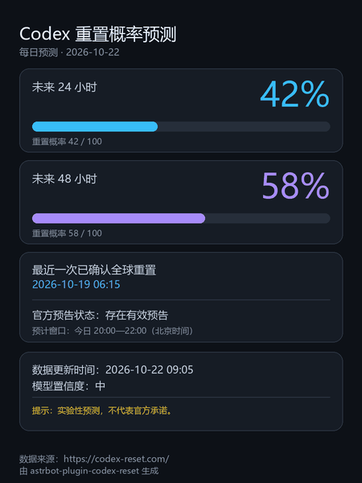

# AI 额度雷达

**把 AI 额度重置公告推送到 QQ 群。** 群管理员可以按产品订阅，通知附带适用范围和来源链接。

`v1.6.2` · AstrBot `>=4.16,<5` · Python `>=3.12` · QQ 适配器 `aiocqhttp`（OneBot v11）

## 能监控什么

| 产品 | 订阅名 | 推送内容 |
|---|---|---|
| Codex | `codex` | 重置确认、预警、额外权益和 24/48 小时实验性预测，可选每日预测图片 |
| Claude / Claude Code | `claude` | 公开重置公告和可领取的重置权益 |
| Grok Bot | `grok-bot` | Grok Bot 额度动态 |
| Grok Build | `grok-build` | Grok Build 额度动态 |
| Antigravity Gemini | `antigravity-gemini` | Google Antigravity 内 Gemini 模型的额度重置 |

首次成功采集只记录历史。之后只推送新增事件或状态变化，重载后按已有记录去重。数据源跟踪的是公开公告，个人额度和续期时间请在相应产品的账户页面查看。

## 快速开始

1. 在 AstrBot WebUI 使用 [GitHub 仓库地址](https://github.com/kasumi-ppp/astrbot_plugin_codex_reset)安装插件并启用。手动安装时，将仓库放到 `data/plugins/astrbot_plugin_codex_reset`，在 AstrBot 的 Python 环境中安装插件的 `requirements.txt`。
2. 在插件配置中开启采集总开关，再开启需要的产品。Claude、Grok Bot、Grok Build 和 Antigravity Gemini 默认关闭。
3. AstrBot 管理员在目标 QQ 群执行以下命令，以 Claude 为例。将 `claude` 换成表里的订阅名即可切换产品。

   ```text
   /cr subscribe claude
   /cr status
   /cr test claude
   ```

`/cr status` 可查看本群订阅和各产品的采集状态。收到标有「测试消息」的回执，表示 QQ 发送通道可用。连续测试不同产品时，每条 `/cr test` 间隔至少 60 秒。

| 常用命令 | 用途 |
|---|---|
| `/cr subscribe [产品]` | 订阅该产品，省略时订阅 Codex |
| `/cr unsubscribe [产品]` | 退订该产品，省略时取消本群所有订阅 |
| `/cr forecast`、`/cr history` | 查看 Codex 预测或重置历史 |
| `/cr help` | 查看完整命令。若有指令冲突，用 `/codexreset` 代替 `/cr` |

## Codex 每日预测图片

可选功能，默认关闭。在插件配置开启「每日预测图片」后，管理员在订阅 Codex 的群内执行 `/cr set daily on`。默认北京时间 09:00 发送。可用 `/cr test image` 试发，或用 `/cr report` 查看当前报告。

<details>
<summary>查看预测卡片示例</summary>



</details>

## 数据来源与帮助

- 数据来自第三方公开站点，通知附带来源。Codex 概率为实验性估计。[Codex Reset](https://codex-reset.com/) · [Claude Reset](https://claudereset.org/) · [QuotaResets](https://quotaresets.com/) · [AGY Resets](https://www.agyresets.com/)
- Docker 部署请持久化 AstrBot 的 `data/` 目录，以保留订阅和去重记录。遇到 HTTP 403、采集失败或群内收不到消息，可按手册逐项检查。[服务器验收与排障](docs/ACCEPTANCE-RUNBOOK.md)
- [进阶用法](docs/usage-notes.md) · [版本记录](CHANGELOG.md) · [AGPL-3.0 许可证](LICENSE)
