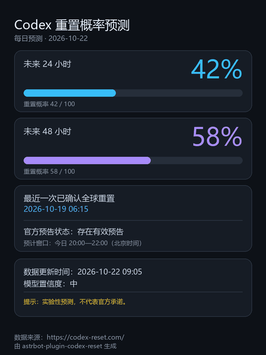

<p align="center">
  <a href="LICENSE"></a>
  <a href="https://github.com/kasumi-ppp/astrbot_plugin_codex_reset"></a>
  <a href="https://astrbot.app">=4.16,<5"></a>
  <a href="https://github.com/botuniverse/onebot-11"></a>
  <a href="https://www.python.org/">=3.12"></a>
</p>

# 🛰️ Codex 重置雷达

AstrBot 插件：读取第三方站点 [codex-reset.com](https://codex-reset.com/) 的公开数据，向订阅的 QQ 群推送
**Codex 全球重置确认、提前预警、重置概率、额外重置权益动态**四类消息。

- 版本 `v1.3.0`｜作者 `kasumi-ppp`｜许可 **AGPL-3.0**｜Python `>=3.12`｜AstrBot `>=4.16,<5`｜平台 `aiocqhttp`（OneBot v11）
- 每条消息都含独立一行 `数据来源：https://codex-reset.com/`（**不可关闭**，许可要求）

## 🚀 功能

| 类别 | 触发条件 | 消息措辞要点 |
|---|---|---|
| **F01 确认重置** | 站点 `group=reset` 且 `announcement_state=announced` 且 `confirmed=true`；或 `latest_alert` 为 `reset/confirmed`；或 `last_reset_at` 前进 | 唯一允许出现「已确认」的消息；跨端点同一事实只推 1 条 |
| **F02 提前预警** | 站点出现新的 `latest_alert(watch/active)` | 明确「尚未确认」；无窗口时固定输出「预计窗口：暂无明确预计时段」，绝不编造小时数 |
| **F03 概率预测** | 24h/48h 概率连续 `forecast_confirm_samples` 次达标（滞回 + 冷却 + 单日上限） | 标注「实验性预测」「不代表官方承诺」，绝不出现「已确认」「即将重置」 |
| **F04 额外重置权益** | `group=credits` 且 `banked_state ∈ {announced, arriving, available}` | 说明「网站记录该权益已可用（不代表所有账号可用）」；`unknown` 静默入库不推送（`banked_grant` 仅作展示、不参与判定，见 `docs/QA-REPORT.md` P2-08） |
| **F07 更正** | 已推送的预告过期/被站点更正/重置被降级 | 「此前的重置预告未获确认」；同一原因只发一次；若重置确认**落在窗口内**则不再补发更正 |

- **多群订阅**：每群独立开关四类通知、24h/48h 阈值与每日图片，WebUI 卡片与 `/cr set` 双向同步；
- **重启不刷屏**：`logical_events` 以 `(logical_id, state_version)` 去重，重启后历史事件不重推；
- **礼貌采集**：固定 UA、请求间隔 ≥60s、429 尊重 `Retry-After`、失败按 2/4/8/15 分钟退避；
- **陈旧抑制 + 审计**：`feed.stale` 或数据过旧时仍入库但不推送；SQLite 持久化 + 审计 JSONL（不记消息正文）。

### 每日预测图片（默认关闭）

每天 `daily_report_time`（默认 `09:00`，时区 `Asia/Shanghai`）向开启的群发送一张 900×1200 预测卡片：24h/48h 概率与进度条、最近一次**已确认**全球重置、官方预告状态、数据更新时间与置信度；每群每天至多一张、重启不重复，渲染失败自动降级为等价文本，数据陈旧则当天跳过。



**示意图** · 数据为示例值，非真实预测

<details>
<summary>核心规则（点击展开）</summary>

- **每群每天一张**：`(群, 业务日期)` 数据库主键兜底，重启后当天不重复；
- **深浅双主题**：`daily_report_theme = dark`（深色科技风）/ `light`（浅色简洁风）；
- **文本降级**：渲染失败（缺 CJK 字体/异常/超时）或 `daily_report_text_fallback=true` 时改发等价文本；
- **结果未知不补发**：图片发送超时记为 `uncertain`，不再补发文本，避免重复刷屏；
- **陈旧不发 + 失败重试**：数据超 `max_source_age_minutes` 跳过并记 `skipped`；明确失败按
  `daily_report_retry_minutes` 重试，超 `daily_report_expiry_minutes` 到期窗口后跳过当日；
- **只读实例不发图**；`/cr report`、`/cr test image` 不占用当日自动额度。

补发窗口、去重粒度与时区语义见 [`docs/usage-notes.md`](docs/usage-notes.md) §4.2，完整变更记录见 [`CHANGELOG.md`](CHANGELOG.md) 的 v1.3.0 段。

</details>
## 📦 安装

**方式 A：插件市场** — 在 AstrBot WebUI →「插件」→「市场」中搜索 **Codex 重置雷达**（`astrbot_plugin_codex_reset`）安装并启用。

**方式 B：Git 克隆**

```bash
cd <AstrBot>/data/plugins
git clone https://github.com/kasumi-ppp/astrbot_plugin_codex_reset.git
pip install -r astrbot_plugin_codex_reset/requirements.txt
```

启用后按需调整配置（见下文「配置」）。默认**不会**主动推送任何消息，需管理员在目标群内执行
`/cr subscribe` 才会开始向该群推送。

> [!IMPORTANT]
> Docker 部署必须把 AstrBot 的 `data/` 挂为**持久卷**（`volumes: - ./data:/AstrBot/data`），
> 否则容器重建会丢失订阅与去重状态（表现为：重新订阅后才能收到推送，且可能重复收到旧消息）。
>
> ```
> data/plugin_data/astrbot_plugin_codex_reset/
> ├── codex_reset.db     # SQLite（订阅、快照、逻辑事件、投递队列、预测状态、日报记录）
> ├── codex_reset.db-wal
> └── audit/audit-YYYY-MM.jsonl
> ```

## 💬 命令

主指令 `/cr`，别名 `/codexreset`（完全等价）；被其他插件占用时请改用 `/codexreset`，启动日志与
`/cr help` 都会给出该提示。

| 命令 | 功能 | 权限 | 限频 | 是否请求上游 |
|---|---|---|---|---|
| `/cr`、`/cr status` | 监控状态、最近采集时间、24h/48h 概率、新鲜度 | 群成员 | 15s | 否 |
| `/cr forecast` | 预测详情 + 置信度 + 实验性声明 | 群成员 | 15s | 否 |
| `/cr latest` | 最近一次已确认重置 + 原始链接 | 群成员 | 15s | 否 |
| `/cr credits` | 最近额外重置权益动态 | 群成员 | 15s | 否 |
| `/cr history [n]` | 最近 n 条**已确认重置**（默认 3，上限 10，超出截断提示；已撤回的更正不计入） | 群成员 | 15s | 否 |
| `/cr help` | 指令说明 + 权限表 + `/codexreset` 备用说明 | 群成员 | 15s | 否 |
| `/cr subscribe` | 订阅当前群（`umo` 取自真实群会话） | AstrBot 管理员 | 5s | 否 |
| `/cr unsubscribe` | 取消当前群订阅 | AstrBot 管理员 | 5s | 否 |
| `/cr settings` | 本群生效配置与来源（群覆盖 / 全局默认） | AstrBot 管理员 | 5s | 否 |
| `/cr set reset\|watch\|forecast\|credits\|daily on\|off` | 按群开关一类通知（`daily` = 每日预测图片） | AstrBot 管理员 | 5s | 否 |
| `/cr set p24\|p48 <0-100>` | 按群设置概率阈值（越界拒绝并回显合法区间） | AstrBot 管理员 | 5s | 否 |
| `/cr groups` | 订阅群列表 + 推送健康（最近成功/失败、uncertain 计数），建议私聊 | AstrBot 管理员 | 10s | 否 |
| `/cr report` | 立即生成并发送当日预测图片（手动触发，**不占用**每日自动额度） | AstrBot 管理员 | 60s | 否 |
| `/cr test` | 当前群发送一条标注「测试」的样例消息（不入库、不建投递） | AstrBot 管理员 | 60s | 否 |
| `/cr test image` | 发送一张标注「测试图片」的当日预测图片（不入库、不影响日报去重） | AstrBot 管理员 | 60s | 否 |

所有查询命令**只读内存缓存与 SQLite**，不会触发任何上游请求，响应不会被采集阻塞（AC-21）。
管理类命令要求 `event.is_admin()`，且**订阅必须来自真实群会话**（私聊 `/cr subscribe` 会被拒绝）；
**只读模式**下（同库另一实例在运行）只提供查询，写指令统一回复「只读模式」。
审计、限频与 `uncertain` 语义见 [`docs/usage-notes.md`](docs/usage-notes.md)。

## ⚙️ 配置

`_conf_schema.json` 共 26 个字段，「可被群覆盖」列为「是」的可用 `/cr set` 或 WebUI 卡片按群调整。

| 字段 | 类型 | 默认 | 说明 | 可被群覆盖 |
|---|---|---|---|---|
| `enable_monitor` | bool | `true` | 总开关；关闭后不采集，但投递队列继续消化，查询读缓存 | 否 |
| `enable_confirmed_reset` | bool | `true` | 推送「重置已确认」 | 是 |
| `enable_watch` | bool | `true` | 推送「提前预警」 | 是 |
| `enable_forecast` | bool | `true` | 推送「概率预测」 | 是 |
| `enable_credits` | bool | `true` | 推送「额外权益动态」 | 是 |
| `threshold_24h` | int | `50` | 24h 阈值（0=关闭该窗口） | 是 |
| `threshold_48h` | int | `70` | 48h 阈值（0=关闭该窗口） | 是 |
| `forecast_confirm_samples` | int | `2` | 连续达标采样次数（<2 抬到 2） | 否 |
| `forecast_cooldown_hours` | int | `12` | 同群两条预测的最短间隔（1-72） | 否 |
| `forecast_daily_max_per_group` | int | `2` | 同群每个自然日最多预测条数（1-10） | 否 |
| `time_zone` | string | `Asia/Shanghai` | 消息时间显示时区（IANA 名，非法回落并告警） | 否 |
| `request_spacing_seconds` | int | `60` | 两次请求最小间隔（<60 强制抬到 60） | 否 |
| `max_source_age_minutes` | int | `10` | 超过该分钟数视为陈旧：入库但不推送（1-120） | 否 |
| `max_catchup_hours` | int | `6` | 启动补发回溯小时数（0-24） | 否 |
| `enable_catchup` | bool | `false` | 启动时补发最近遗漏（每群最多 1 条摘要） | 否 |
| `allow_at_all` | bool | `false` | **仅**确认重置时尝试 `@全体成员`（仅 aiocqhttp）；预警/概率/权益/日报一律不 @ | 否 |
| `enable_daily_report` | bool | `false` | 每日预测图片总开关（默认关闭） | 是 |
| `daily_report_time` | string | `09:00` | 每日发送时间 `HH:MM`（非法回落到默认并告警） | 否 |
| `daily_report_timezone` | string | `Asia/Shanghai` | 每日发送时区（IANA 名，非法回落并告警） | 否 |
| `daily_report_theme` | string | `dark` | 图片主题 `dark`/`light`（非法回落 `dark`） | 否 |
| `daily_report_retry_minutes` | int | `5` | 日报失败重试间隔（1-60） | 否 |
| `daily_report_expiry_minutes` | int | `30` | 日报到期窗口长度（1-240；小于重试间隔时告警） | 否 |
| `daily_report_text_fallback` | bool | `true` | 图片渲染/发送**已知失败**时改发文本卡片 | 否 |
| `show_source_link` | bool | `true` | 署名行开关；**不可关闭**（置 false 仍渲染并告警） | 否 |
| `admin_only_subscription` | bool | `true` | 预留字段：当前固定只放行 `event.is_admin()` | 否 |
| `group_overrides` | template_list | `[]` | 群级配置卡片（由 `/cr subscribe` 与 `/cr set` 自动维护） | — |

**有效配置 = 全局默认 ⊕ 群级覆盖**：`subscriptions.settings_json` 只保存「显式覆盖过」的字段，未覆盖字段继续继承全局默认；`/cr set` 把值改回全局默认时会删除该覆盖字段，重新回到「继承」语义。
每日预测图片采用**全局总开关 + 群级开关**两级：`enable_daily_report=false` 时任何群都不发送，全局开启后还需对本群 `/cr set daily on`（订阅动作本身不会自动打开日报）；`/cr report` 与 `/cr test image` 是手动/测试通道，不受这两级开关约束，也不消耗当日自动额度。群覆盖完整语义见 [`docs/usage-notes.md`](docs/usage-notes.md) §4。

## ⚠️ 局限与注意事项

1. **非官方数据**：`codex-reset.com` 是第三方独立站点，接口可能变更或下线；插件对字段缺失/枚举污染做
   fail-closed 降级，但不保证功能永久可用。
2. **实验性预测**：24h/48h 概率由站点模型给出，插件只做阈值转发，**不代表 OpenAI 官方承诺**。
3. **exactly-once 不可保证**：发送超时或进程被强杀时消息可能已送达但未被确认，插件记为 `uncertain`
   并**不自动重发**，极端情况下可能漏一条；可用 `/cr groups` 查看计数。
4. **仅 `aiocqhttp`**：`@全体成员` 仅在 `aiocqhttp` 且 `allow_at_all=true` 时以真实 `At` 组件发送。
5. **单实例建议**：同一数据库被两个 AstrBot 实例同时写入时，去重靠唯一约束兜底，仍可能重复投递。
6. **图片依赖中文字体**：精简 Linux 镜像常缺 CJK 字体，找不到字体时该次日报降级为文本卡片，
   装 `fonts-noto-cjk` 即可恢复。

完整已知限制（只读判定一次性、`uncertain` 终态语义等）见
[`docs/ACCEPTANCE.md#31-已知限制上线前请知悉`](docs/ACCEPTANCE.md#31-已知限制上线前请知悉)。

## 📄 数据来源与许可

- 数据来源：[https://codex-reset.com/](https://codex-reset.com/)（公开 JSON：`/api/forecast`、
  `/api/timeline`、`/api/feed`）。插件仅做只读 GET，不写入、不绕过任何访问限制。
- 每条展示上游数据的消息都包含 `数据来源：https://codex-reset.com/`，该行**不可关闭**。
- 本项目以 **AGPL-3.0** 发布（见 [`LICENSE`](LICENSE)），二次分发/修改需保留同样的许可与署名要求。

## 🔧 故障排查

| 现象 | 排查方向 |
|---|---|
| 群内没有任何推送 | ① 是否执行过 `/cr subscribe`；② `enable_monitor` 是否为 `true`；③ `/cr settings` 看各开关；④ `/cr status` 的「最近采集」是否长时间不更新 |
| `/cr` 没有响应 | 可能被其他插件占用，改用 `/codexreset`；启动日志中搜索 `/cr 可能被占用` |
| 权限被拒 | 管理指令要求 AstrBot 管理员；`subscribe/unsubscribe` 还必须在**群会话**内执行 |
| 重启后重复收到旧消息 | 确认 `data/plugin_data/astrbot_plugin_codex_reset` 为持久卷；否则去重状态会丢失 |
| 每天没收到预测图片 | ① 全局 `enable_daily_report`（默认 `false`）；② 本群 `/cr set daily on`；③ `daily_report_time`/`daily_report_timezone`；④ 用 `/cr report` 手工验证 |
| 预测图片变成文字 | 环境缺少中文字体，或发送已知失败已按 `daily_report_text_fallback` 降级；安装 CJK 字体即可恢复 |

更多现象（429/502 退避、只读模式、时间显示、`/cr test` 限频等）见
[`docs/ACCEPTANCE-RUNBOOK.md#7-判读表`](docs/ACCEPTANCE-RUNBOOK.md#7-判读表)。
日志统一带 `[codex-reset][模块]` 前缀，排障时建议 `grep "codex-reset"`。

## 🧪 开发与验收

| 文档 | 内容 |
|---|---|
| [`docs/ACCEPTANCE.md`](docs/ACCEPTANCE.md) | AC-01 ~ AC-26 验收矩阵、人工联调清单、已知限制 |
| [`docs/ACCEPTANCE-RUNBOOK.md`](docs/ACCEPTANCE-RUNBOOK.md) | 真实环境验收执行单（含每日图片 8 步真机流程） |
| [`docs/usage-notes.md`](docs/usage-notes.md) | 权限、只读模式、`uncertain` 语义、群级覆盖 |
| [`docs/architecture.md`](docs/architecture.md) | 分层架构、七表 DDL、决策记录（D-01 ~ D-12） |
| [`docs/QA-REPORT.md`](docs/QA-REPORT.md) | 历轮 QA 缺陷与修复记录 |
| [`CHANGELOG.md`](CHANGELOG.md) | 版本变更 |

```bash
python -m pytest tests -q                          # 全量测试
python -m ruff check services tests main.py scripts
```

复现命令与环境准备见 [`docs/ACCEPTANCE.md#4-复现命令`](docs/ACCEPTANCE.md#4-复现命令)。分层纪律：`services/**` **不得** `import astrbot`（由 `tests/test_schema.py` 守护），只有 `main.py` 可以接触 AstrBot 框架对象。

## 📢 免责声明

本插件为社区非官方工具，与 OpenAI、Anthropic 或 `codex-reset.com` 均无隶属关系。所有数据与预测来自
第三方站点，可能不准确、延迟或中断；插件按「现状」提供，不构成任何服务承诺或订阅建议。因使用本插件
产生的任何直接或间接损失，作者不承担责任。请自行判断是否依赖这些信息做出决策。
