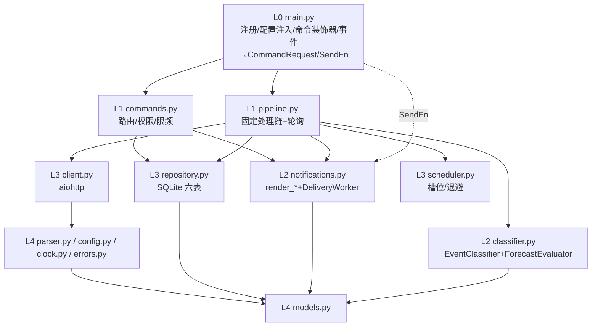
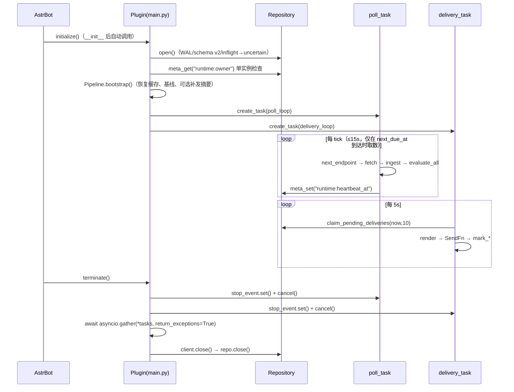
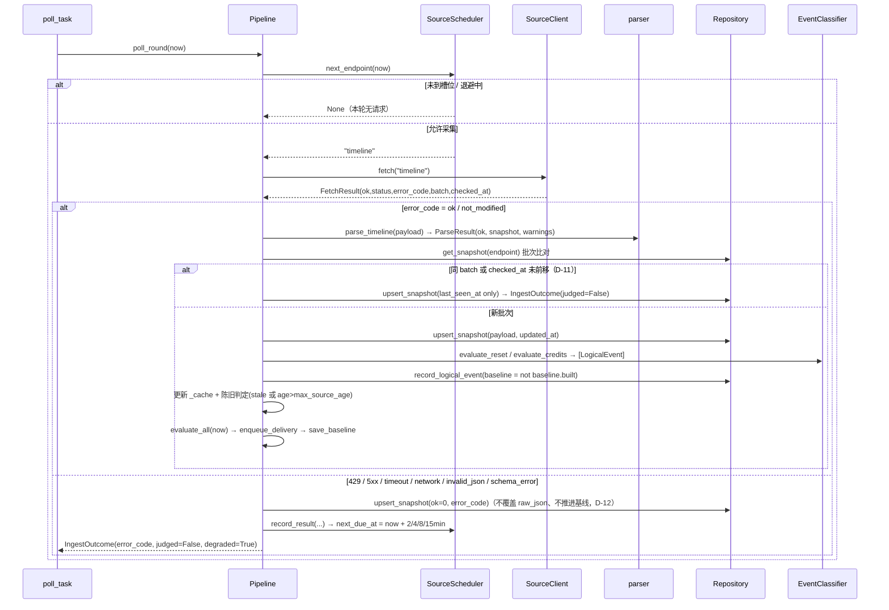
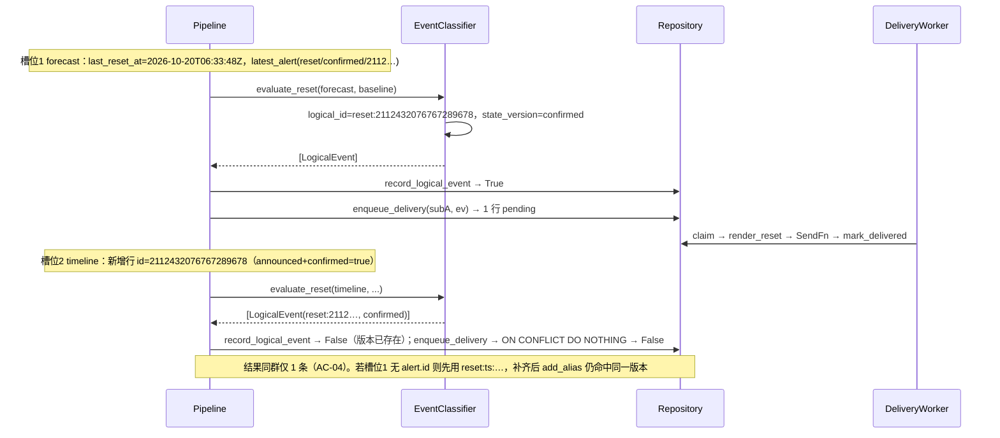
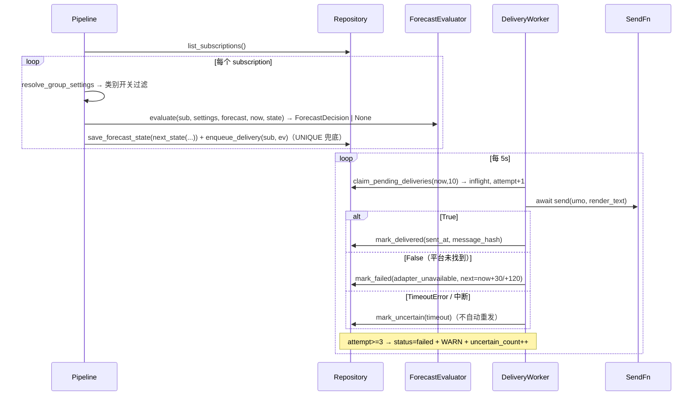
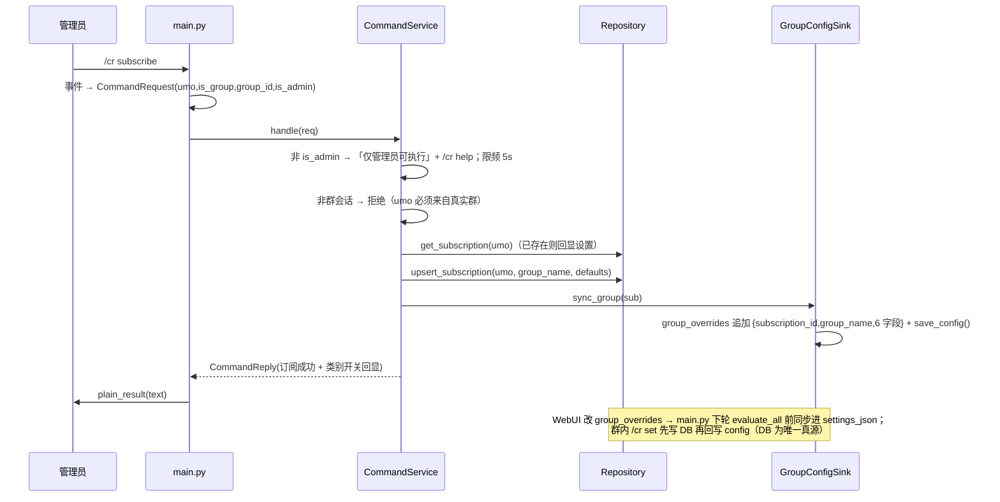
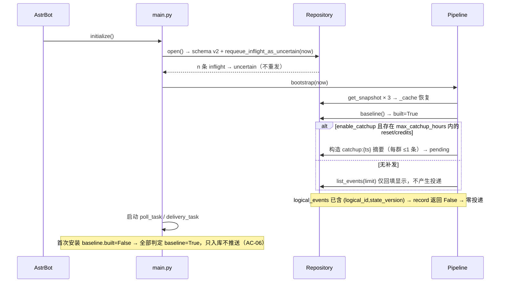

# Codex 重置雷达 V1.2 — 系统架构设计 + 有序任务列表

> 依据 `docs/PRD-confirmation.md`（D-01~D-12、命令表、配置表、模板、AC-01~AC-24），冲突以其为准。基线 Python 3.12 / AstrBot 4.29.1 / OneBot v11 / Win+Linux｜`v1.2.0`｜`kasumi-ppp`
> 本文不含实现代码，只有签名、DDL、算法规则与伪代码（≤10 行）。

## A. 总体设计

### A.1 分层与依赖方向



**硬约束**：`services/**` 禁止 `import astrbot`；`SendFn = Callable[[str, str], Awaitable[bool]]` 是唯一出站通道，仅在 `main.py` 实现。依赖严格单向 `main → pipeline/commands → classifier/notifications/repository → parser/client/models/clock`；`classifier` 不 import `repository`，`repository` 不 import `pipeline`。

### A.2 模块职责一句话

| 文件 | 职责 |
|---|---|
| `main.py` | Star 子类：注册 `cr` 命令组、AstrBotConfig→`PluginSettings`、建/停两个后台任务、`SendFn` 适配、群配置回写 `group_overrides` |
| `models.py` / `errors.py` / `clock.py` | 全部 frozen dataclass + `SendFn`/`ReadModel` Protocol（零副作用）；错误码与异常、`USER_AGENT`；`Clock`+`FakeClock` |
| `config.py` / `parser.py` | dict→`PluginSettings`（校验/回落/群覆盖合并）；JSON→快照（fail-closed + 逐字段降级，AC-23） |
| `client.py` | aiohttp GET 三端点；状态/异常→`FetchResult(error_code)`；解析 `x-published-*` |
| `scheduler.py` | `forecast→timeline→forecast→feed` 轮换、≥60s 间隔、强制 timeline、2/4/8/15min 退避 |
| `classifier.py` | `EventClassifier`（reset/watch/correction/credits + id/版本生成）、`ForecastEvaluator`（纯函数） |
| `repository.py` | aiosqlite 单写锁事务、六表 CRUD、别名、投递队列、预测状态、审计 JSONL |
| `notifications.py` | `render_*` 纯文本模板（AC-20）+ `DeliveryWorker`（认领/重试/uncertain） |
| `commands.py` | `CommandRequest→CommandReply`、子命令路由、权限、`(umo,子命令)` 限频、配置编排 |
| `pipeline.py` | 固定处理链 `bootstrap/poll_round/ingest/evaluate_all` + 内存快照缓存（`ReadModel`） |

### A.3 固定处理链落点

| 固定步骤 | 落点 |
|---|---|
| ① 采集接口 | `SourceScheduler.next_endpoint()` → `SourceClient.fetch()`，由 `Pipeline.poll_round()` 驱动 |
| ② 校验快照 | `parser.parse_forecast/timeline/feed()` → `ParseResult`（失败 `schema_error`，D-12 不推进基线） |
| ③ 更新缓存 | `Pipeline._gate()`（批次去重 D-11）→ `Repository.upsert_snapshot()` → 更新 `Pipeline._cache` |
| ④ 归并逻辑事件 | `EventClassifier.evaluate_*` → `Repository.find_logical_by_alias/add_alias/record_logical_event` |
| ⑤ 按群评估 | `Pipeline.evaluate_all()`：逐订阅 → `resolve_group_settings` → 类别开关 → `ForecastEvaluator.evaluate` |
| ⑥ 创建投递记录 | `Repository.enqueue_delivery()`（`UNIQUE(subscription_id,logical_id,state_version)` 兜底） |
| ⑦ 发送消息 | `DeliveryWorker.run_once()` → `claim_pending_deliveries()` → `render_*` → `SendFn(umo,text)` |
| ⑧ 保存结果 | `mark_delivered/mark_failed/mark_uncertain`（attempt、next_attempt_at、sent_at、error_code） |

### A.4 两个后台任务的生命周期



| 约束 | 实现 |
|---|---|
| 无孤儿任务 + 幂等启动 | 句柄存 `self._tasks`；`terminate()` 必 `cancel()`+`gather(...,return_exceptions=True)` 再关 session/DB；`initialize()` 若 `self._tasks` 非空直接返回（防热重载双启动） |
| 单实例 | `meta["runtime:owner"]=f"{pid}:{boot_uuid}"`，`runtime:heartbeat_at` 每轮更新；启动时 owner≠自己且心跳<2×spacing → **只读模式**（`enable_monitor` 运行时 false）+ERROR 日志，不退出插件（保证 `/cr status` 可用） |
| 采集中断 | loop 内 `try/except` + 结构化日志，绝不冒泡终止任务 |
| 重启恢复 | 启动把 `status='inflight'` → `'uncertain'`（不自动重发，F08）；`logical_events` 保留全部 `(logical_id,state_version)` → 不刷屏（AC-17） |

## B. 文件清单

| 相对路径 | 类型 | 职责 | 预估行数 |
|---|---|---|---|
| `main.py` | 源码 | Star 子类、命令注册、配置注入、`SendFn`、任务编排、`GroupConfigSink` | 380 |
| `_conf_schema.json` / `metadata.yaml` | 配置 | 19 个冻结字段 + `group_overrides` template_list；插件元数据 | 138 |
| `requirements.txt` / `pyproject.toml` | 配置 | `aiohttp>=3.9`、`aiosqlite>=0.20`、`tzdata>=2024.1`；ruff(110,py312)+pytest | 41 |
| `services/__init__.py` | 源码 | 包标记 + `__all__` | 6 |
| `services/models.py` / `errors.py` / `clock.py` | 源码 | dataclass 与 Protocol；错误码/异常/`USER_AGENT`；`Clock`+`FakeClock` | 385 |
| `services/config.py` / `parser.py` | 源码 | 配置解析与回落；三端点解析、逐字段降级 | 490 |
| `services/client.py` / `scheduler.py` | 源码 | 采集 + 错误映射 + header 解析；槽位轮换、间隔、退避 | 310 |
| `services/classifier.py` / `repository.py` | 源码 | 事件判定 + id/版本生成 + 预测评估；SQLite 六表 + 别名 + 队列 + 审计 | 950 |
| `services/notifications.py` / `commands.py` | 源码 | 模板渲染 + 投递 Worker；命令路由/权限/限频/回显 | 900 |
| `services/pipeline.py` | 源码 | 处理链 + 缓存 + 补发计划 | 380 |
| `tests/conftest.py` | 测试 | `load_fixture`、`run()`（asyncio.run 包装）、`FakeClock`、`RecordingSend`、`make_repo` | 130 |
| `tests/test_parser.py` | 测试 | 解析、字段缺失、枚举污染、坏 JSON | 180 |
| `tests/test_repository.py` | 测试 | DDL、唯一约束、别名、事务、inflight 恢复 | 200 |
| `tests/test_scheduler.py` | 测试 | 轮换、≥60s、强制 timeline、退避 | 120 |
| `tests/test_classifier.py` / `test_watch.py` | 测试 | reset 三来源、watch active/expired/corrected/无窗口 | 380 |
| `tests/test_credits.py` / `test_forecast.py` | 测试 | 权益版本前移、采样/滞回/冷却/单日上限 | 340 |
| `tests/test_templates.py` / `test_dedupe.py` | 测试 | AC-20 署名与禁词、重试/uncertain/并发 | 340 |
| `tests/test_pipeline.py` / `test_commands.py` | 测试 | 处理链集成、陈旧抑制、重启、补发；权限/限频/同步 | 470 |
| `tests/fixtures/*.json` | 测试 | 见 §F.1（20 个文件） | — |
| `README.md` / `CHANGELOG.md` | 文档 | 功能、命令、配置、免责声明；v1.2.0 变更 | 190 |

## C. 数据结构与接口

### C.1 dataclass（字段 / 类型 / 默认值）

```python
# services/models.py —— 除 DeliveryTask/ForecastState 外均为 @dataclass(frozen=True, slots=True)（省略装饰器行）
# 时间字段一律 timezone-aware UTC
class AlertWindow:
    label: str; start_at: datetime | None = None; end_at: datetime | None = None
    time_zone: str | None = None; target_kind: str | None = None; target_at: datetime | None = None  # 窗口原文
class LatestAlert:
    id: str; kind: str; state: str; summary: str          # kind: watch|reset  state: active|expired|confirmed
    source_at: datetime | None = None; url: str | None = None; score: int | None = None
    window: AlertWindow | None = None; pending: str | None = None          # done|on_its_way
    corrected: bool = False; confirmation_source: str | None = None
    observed_at: datetime | None = None; confirmed_at: datetime | None = None; confirmation_url: str | None = None
class ForecastSnapshot:
    updated_at: datetime; rounded_24h: int; rounded_48h: int; confidence: str
    last_reset_at: datetime | None = None; latest_alert: LatestAlert | None = None
    official_signal: dict[str, Any] | None = None
    fetched_at: datetime = None; batch: str | None = None; checked_at: datetime | None = None
class TimelineEvent:
    id: str; date: str; type: str; group: str; summary: str
    text: str | None = None; url: str | None = None
    announced_at: datetime | None = None; effective_at: datetime | None = None; official_window: str | None = None
    announcement_state: str | None = None      # announced|none|None → 缺失即 fail-closed（D-01）
    banked_state: str | None = None            # announced|arriving|available|unknown|None
    banked_grant: bool = False; confirmed: bool = False; preview: bool = False
    source: str | None = None; source_label: str | None = None; confidence: str | None = None
    reset_kind: str | None = None; observed_variant: str | None = None
    audience: tuple[str, ...] = (); incident_links: tuple[str, ...] = (); reason_tags: tuple[str, ...] = ()
class TimelineSnapshot:
    updated_at: datetime; events: tuple[TimelineEvent, ...]
    fetched_at: datetime = None; batch: str | None = None; checked_at: datetime | None = None
class BankedObservation:
    id: str; kind: str; source: str; banked_state: str; title: str; text: str
    at: datetime | None = None; after_announcement: bool = True
class FeedSnapshot:
    fetched_at: datetime; stale: bool
    tweets: tuple[dict[str, Any], ...]                 # 仅新鲜度/证据，不参与判定
    banked_observations: tuple[BankedObservation, ...] = ()
    events: tuple[TimelineEvent, ...] = ()             # 与 timeline 同构
    newest_post_at: datetime | None = None
    batch: str | None = None; checked_at: datetime | None = None
class LogicalEvent:
    logical_id: str; kind: str; group_kind: str; state_version: str
    occurred_at: datetime; payload: dict[str, Any]
    source_refs: tuple[str, ...] = (); correction_reason: str | None = None
class DeliveryTask:                                    # 可变态
    id: int; subscription_id: str; umo: str; logical_id: str; state_version: str
    kind: str; payload: dict[str, Any]; status: str = "pending"; attempt: int = 0
    next_attempt_at: datetime | None = None; created_at: datetime = None
    updated_at: datetime = None; error_code: str | None = None
class GroupSettings:
    enable_confirmed_reset: bool = True; enable_watch: bool = True
    enable_forecast: bool = True; enable_credits: bool = True
    threshold_24h: int = 50; threshold_48h: int = 70
class PluginSettings:
    enable_monitor: bool = True; defaults: GroupSettings = field(default_factory=GroupSettings)
    forecast_confirm_samples: int = 2; forecast_cooldown_hours: int = 12
    forecast_daily_max_per_group: int = 2; time_zone: str = "Asia/Shanghai"
    request_spacing_seconds: int = 60; max_source_age_minutes: int = 10
    max_catchup_hours: int = 6; enable_catchup: bool = False; allow_at_all: bool = False
    show_source_link: bool = True; admin_only_subscription: bool = True
    group_limit: int = 50; warnings: tuple[str, ...] = ()
class FetchResult:
    endpoint: str; ok: bool; status: int; error_code: str
    payload: dict[str, Any] | None = None; fetched_at: datetime = None
    batch: str | None = None; cache_status: str | None = None; checked_at: datetime | None = None; latency_ms: int = 0
    retry_after: int | None = None
class CommandRequest:
    umo: str; is_group: bool; group_id: str; platform: str; sender_id: str
    is_admin: bool; subcommand: str; args: tuple[str, ...] = (); request_id: str = ""
    raw_text: str = ""; received_at: datetime = None
class CommandReply:
    text: str; silent: bool = False; error: str | None = None; audit: dict[str, Any] | None = None
class IngestOutcome:
    endpoint: str; error_code: str; judged: bool = False; baseline_only: bool = False
    snapshot_stored: bool = False; degraded: bool = False
    new_events: tuple[LogicalEvent, ...] = (); deliveries_created: int = 0
class ForecastDecision:
    logical_id: str; state_version: str; window_kind: str      # h24|h48|both
    rounded_24h: int; rounded_48h: int; confidence: str; updated_at: datetime
class ForecastState:                                   # 可变态
    subscription_id: str; hits_24h: int = 0; hits_48h: int = 0
    armed_24h: bool = True; armed_48h: bool = True; cooldown_until: datetime | None = None
    day_key: str = ""; day_count: int = 0; epoch_seq: int = 0
    last_prob_24h: int | None = None; last_prob_48h: int | None = None; last_sample_at: datetime | None = None
class Baseline:
    built: bool = False; last_reset_at: datetime | None = None
    watch_source_at: datetime | None = None; built_at: datetime | None = None
class SnapshotRow:
    endpoint: str; ok: bool; error_code: str; fetched_at: datetime | None
    updated_at: datetime | None; checked_at: datetime | None
    batch: str | None; cache_status: str | None; last_seen_at: datetime | None
class ParseResult(Generic[T]):
    ok: bool; error_code: str; snapshot: T | None = None; warnings: tuple[str, ...] = ()

SendFn = Callable[[str, str], Awaitable[bool]]              # (umo, text) → 平台是否找到
class ReadModel(Protocol):                                  # 命令层只读视图，绝不触发上游请求
    def forecast(self) -> ForecastSnapshot | None: ...
    def timeline(self) -> TimelineSnapshot | None: ...
    def feed(self) -> FeedSnapshot | None: ...
    def freshness(self, now: datetime) -> tuple[datetime | None, bool]: ...   # (last_ok_fetch, stale)
```

### C.2 Service 公开签名

```python
# clock.py —— Clock(utcnow/sleep/monotonic) + RealClock + FakeClock(advance/set_now/记录 sleep)
# config.py —— 校验口径：时区非法→Asia/Shanghai+warning；spacing<60→60+warning；阈值 clamp 0..100；
#              samples<2→2；cooldown 1..72；daily_max 1..10；max_age 1..120；catchup 0..24
def build_plugin_settings(raw: Mapping[str, Any]) -> PluginSettings
def parse_group_settings(raw: Mapping[str, Any]) -> GroupSettings
def resolve_group_settings(plugin: PluginSettings, override: GroupSettings | None) -> GroupSettings
def settings_to_json(g: GroupSettings) -> str
def parse_timezone(name: str) -> tuple[ZoneInfo, str | None]

# parser.py
def parse_forecast(payload, *, fetched_at: datetime, batch=None, checked_at=None) -> ParseResult[ForecastSnapshot]
def parse_timeline(payload, *, fetched_at: datetime, batch=None, checked_at=None) -> ParseResult[TimelineSnapshot]
def parse_feed(payload, *, fetched_at: datetime, batch=None, checked_at=None) -> ParseResult[FeedSnapshot]
def parse_event(row: Mapping[str, Any]) -> tuple[TimelineEvent | None, tuple[str, ...]]
def parse_iso(value: Any) -> datetime | None                       # 必转 timezone.utc
def coerce_enum(value, allowed: Iterable[str], default: str | None) -> tuple[str | None, bool]

# client.py
class SourceClient:
    def __init__(self, *, session=None, session_factory=None, clock: Clock, timeout_s: float = 15.0,
                 base_url: str = "https://codex-reset.com", user_agent: str = USER_AGENT) -> None
    # fetch: 200→ok（JSON 解码失败→invalid_json）；304→not_modified；429→http_429(Retry-After)
    # 5xx→http_5xx；TimeoutError→timeout；ClientError/OSError→network
    async def fetch(self, endpoint: str) -> FetchResult
    async def close(self) -> None

# scheduler.py
class SourceScheduler:
    def __init__(self, *, spacing_seconds: int, clock: Clock,
                 rotation: tuple[str, ...] = ("forecast", "timeline", "forecast", "feed")) -> None
    def next_endpoint(self, now: datetime) -> str | None           # None = 未到槽位/退避中
    def force_timeline(self, reason: str) -> None
    def record_result(self, endpoint: str, error_code: str, now: datetime) -> datetime   # next_due_at
    def consecutive_failures(self) -> int

# classifier.py
def build_logical_id(kind, *, event_id=None, alert_id=None, window_kind=None, anchor_at=None) -> str
def build_state_version(kind, *, state=None, window_start_at=None, banked_state=None,
                        window_kind=None, epoch_seq=0) -> str | None     # None = 不产生版本
class EventClassifier:
    def __init__(self, *, clock: Clock) -> None
    def evaluate_reset(self, *, forecast, timeline, feed, baseline: Baseline) -> list[LogicalEvent]
    def evaluate_reset_correction(self, *, timeline, known: Mapping[str, str]) -> list[LogicalEvent]
    def evaluate_watch(self, *, forecast: ForecastSnapshot, baseline: Baseline,
                       known_alert_ids: frozenset[str]) -> list[LogicalEvent]
    def evaluate_watch_correction(self, *, forecast, previous_alert: LatestAlert | None,
                                  now: datetime) -> list[LogicalEvent]
    def evaluate_credits(self, *, timeline, feed) -> list[LogicalEvent]
class ForecastEvaluator:
    def __init__(self, *, time_zone: ZoneInfo) -> None
    def evaluate(self, subscription_id: str, settings: GroupSettings, snapshot: ForecastSnapshot,
                 now: datetime, state: ForecastState) -> ForecastDecision | None     # 纯函数，不改 state
    def next_state(self, state: ForecastState, settings: GroupSettings, snapshot: ForecastSnapshot,
                   now: datetime, decision: ForecastDecision | None, *,
                   reset_confirmed: bool = False) -> ForecastState
    def day_key(self, now: datetime) -> str

# notifications.py —— 除 Worker 外全为纯函数
def render_reset(ev, *, tz, settings, at_all: bool = False) -> str
def render_watch(ev, *, tz, settings) -> str
def render_forecast_push(dec: ForecastDecision, *, tz, settings) -> str
def render_credits(ev, *, tz, settings) -> str
def render_correction(ev, *, tz, settings) -> str
def render_catchup_summary(evs: Sequence[LogicalEvent], *, tz, settings) -> str
def render_test(*, tz, settings) -> str
def render_query(kind: str, *, read: ReadModel, tz, settings, now: datetime, arg=None) -> str
    # kind ∈ status|forecast|latest|credits|history|help
def format_time(dt, tz, *, with_zone: bool = True) -> str;  def format_day(dt, tz) -> str
def confidence_cn(value: str) -> str;  def banked_state_cn(value: str | None) -> str
class DeliveryWorker:
    def __init__(self, *, repo: Repository, send: SendFn, clock: Clock,
                 settings_provider: Callable[[], PluginSettings], tz: ZoneInfo, batch: int = 10,
                 retry_delays: tuple[int, ...] = (0, 30, 120),
                 degraded: Callable[[datetime], bool] = lambda now: False) -> None
    async def run_once(self, now: datetime) -> int
    async def run(self) -> None
    def stop(self) -> None
# commands.py
RATE_LIMITS = {"status":15,"forecast":15,"latest":15,"credits":15,"history":15,"help":15,
               "subscribe":5,"unsubscribe":5,"settings":5,"set":5,"groups":10,"test":60}
QUERY_COMMANDS = frozenset({"", "status", "forecast", "latest", "credits", "history", "help"})
ADMIN_COMMANDS = frozenset({"subscribe","unsubscribe","settings","set","groups","test"})
class GroupConfigSink(Protocol):
    async def sync_group(self, sub) -> bool: ...
    async def drop_group(self, subscription_id: str) -> bool: ...
    async def persist(self) -> None: ...
class CommandService:
    def __init__(self, *, repo: Repository, read: ReadModel,
                 settings_provider: Callable[[], PluginSettings], sink: GroupConfigSink,
                 clock: Clock, tz_provider: Callable[[], ZoneInfo]) -> None
    async def handle(self, req: CommandRequest) -> CommandReply
    def route(self, subcommand: str) -> str                # 未知子命令 → help + 提示
    def check_rate(self, umo: str, subcommand: str, now: datetime) -> int   # 0=放行，>0=剩余秒

# pipeline.py
class Pipeline:
    def __init__(self, *, repo, client, scheduler, classifier, evaluator, worker,
                 clock: Clock, settings_provider, tz_provider) -> None
    async def bootstrap(self, now: datetime) -> IngestOutcome
    async def poll_round(self, now: datetime) -> IngestOutcome | None
    async def ingest(self, endpoint: str, fetch_result: FetchResult) -> IngestOutcome
    async def evaluate_all(self, now: datetime) -> int
    def forecast(self) / def timeline(self) / def feed(self)               # 缓存读，等价 ReadModel
    def freshness(self, now: datetime) -> tuple[datetime | None, bool]
```

**`Repository`（`services/repository.py`）**——构造 `Repository(db_path: Path, *, clock: Clock, audit_dir: Path | None = None)`：

| 方法 | 签名 | 说明 |
|---|---|---|
| `open` / `close` | `async open() -> None` / `async close() -> None` | WAL、foreign_keys、busy_timeout、建表、版本校验 |
| `upsert_snapshot` | `async (endpoint: str, fetch: FetchResult, *, snapshot_payload: Mapping\|None, updated_at: datetime\|None) -> SnapshotRow` | 失败轮次只写 error_code/last_seen_at |
| `get_snapshot` | `async (endpoint: str) -> SnapshotRow \| None` | 批次去重依据 |
| `list_subscriptions` / `get_subscription` | `async () -> list[SubscriptionRow]` / `async (umo: str) -> SubscriptionRow \| None` | — |
| `upsert_subscription` | `async (*, umo, platform, group_id, group_name, settings) -> SubscriptionRow` | `umo` 唯一 |
| `delete_subscription` | `async (umo: str) -> bool` | 级联删 deliveries/forecast_state |
| `update_subscription_settings` | `async (umo: str, settings: GroupSettings) -> bool` | `/cr set` 写入口 |
| `touch_subscription_health` | `async (subscription_id: str, *, ok: bool, uncertain_delta: int = 0) -> None` | `/cr groups` 数据源 |
| `record_logical_event` | `async (ev: LogicalEvent, *, baseline: bool) -> bool` | **True=`(logical_id,state_version)` 首次出现（可通知）** |
| `find_logical_by_alias` / `add_alias` | `async (alias: str) -> str\|None` / `async (alias: str, logical_id: str) -> None` | meta `alias:*` 承载 D-08 |
| `latest_state_version` / `list_events` | `async (logical_id: str) -> str\|None` / `async (*, group_kind=None, limit: int = 10) -> list[LogicalEvent]` | 版本前移判定；`/cr history` 与补发计划 |
| `enqueue_delivery` | `async (*, sub, ev, status="pending", next_attempt_at=None) -> bool` | `ON CONFLICT DO NOTHING`，False=已存在 |
| `claim_pending_deliveries` | `async (now: datetime, limit: int = 10) -> list[DeliveryTask]` | 置 inflight、attempt+1 |
| `mark_delivered` | `async (task, *, now: datetime, message_hash: str) -> None` | — |
| `mark_failed` | `async (task, *, now, error_code: str, next_attempt_at) -> None` | 重试或终态 failed |
| `mark_uncertain` | `async (task, *, now, error_code: str) -> None` | 终态，不自动重发 |
| `requeue_inflight_as_uncertain` | `async (now: datetime) -> int` | 启动调用 |
| `get_forecast_state` / `save_forecast_state` | `async (subscription_id: str) -> ForecastState` / `async (state, *, now) -> None` | 缺行时返回默认值 |
| `reset_all_forecast_epochs` | `async (now: datetime) -> int` | 确认 reset 后 epoch_seq+1 |
| `subscription_health` | `async () -> list[dict[str, Any]]` | 最近成功/失败、uncertain 计数 |
| `audit` | `async (record: Mapping[str, Any]) -> None` | JSONL + logger，不含消息正文 |
| `meta_get` / `meta_set` / `meta_get_all` | `async (key) -> str\|None` / `async (key, value) -> None` / `async (prefix: str) -> dict[str, str]` | — |
| `baseline` / `save_baseline` | `async () -> Baseline` / `async (b: Baseline) -> None` | 基线持久化 |

### C.3 `logical_id` 与 `state_version` 生成规则（确定性）

| 类别 | `build_logical_id` | `build_state_version` | 说明 |
|---|---|---|---|
| reset（timeline 行） | `reset:{event.id}` | 常量 `confirmed` | 充要条件 `group=="reset" && confirmed is True && announcement_state=="announced"`（D-01/D-02） |
| reset（latest_alert） | `reset:{alert.id}` | `confirmed` | `kind=="reset" && state=="confirmed"`；与 timeline 行同源（D-08） |
| reset（仅 forecast 前进） | `reset:ts:{last_reset_at ISO8601 UTC}` | `confirmed` | 临时键；timeline 补齐后 `add_alias("reset:{id}" → 临时键)`，靠 `UNIQUE` 不重发（AC-03） |
| watch | `watch:{alert.id}` | `{state}:{window.start_at ISO or "nowindow"}` | `state∈active/expired/corrected`；同 id 窗口实质变更才新版（F02/F07） |
| credits | `credits:{event.id}`（feed 同 id 走别名） | `banked_state` | `unknown`/缺失 → 返回 `None`，静默入库不推送（D-03） |
| forecast | `forecast:{sub_id}:{window_kind}` | `{window_kind}:{epoch_seq}` | `h24/h48/both`；`epoch_seq` 见 U-1 |
| correction | 复用原事件 `logical_id` | `expired:…` / `corrected` / `downgraded:{state}` | 每种 `(logical_id,原因)` 只发一次（F07） |
| catchup 摘要 | `catchup:{max_occurred_at ISO}` | `summary` | 每群每次启动最多 1 条（Q-4） |

```text
build_logical_id(kind, ev_id, alert_id, window_kind, anchor_at):        # 伪代码
  reset   → f"reset:{ev_id or alert_id}" if (ev_id or alert_id) else f"reset:ts:{iso(anchor_at)}"
  watch   → f"watch:{alert_id}"        credits → f"credits:{ev_id or alert_id}"
  forecast→ f"forecast:{window_kind}"  (sub_id 由调用方前置，形如 forecast:{sub}:h24)
同轮归一化：候选按 (occurred_at, logical_id) 升序；多个 id 指向同一事实时首个为 canonical，
其余 add_alias → canonical；跨轮由 find_logical_by_alias 命中，故 timeline 迟到补齐不会二次推送。
```

## D. 数据库 DDL（六表，`schema_version=2`）

```sql
PRAGMA journal_mode=WAL; PRAGMA foreign_keys=ON; PRAGMA busy_timeout=5000; PRAGMA synchronous=NORMAL;
CREATE TABLE IF NOT EXISTS meta (
  key TEXT PRIMARY KEY, value TEXT NOT NULL, updated_at TEXT NOT NULL);
CREATE TABLE IF NOT EXISTS subscriptions (
  subscription_id TEXT PRIMARY KEY, umo TEXT NOT NULL UNIQUE,
  platform TEXT NOT NULL DEFAULT '', group_id TEXT NOT NULL DEFAULT '', group_name TEXT NOT NULL DEFAULT '',
  enabled INTEGER NOT NULL DEFAULT 1, settings_json TEXT NOT NULL DEFAULT '{}',
  subscribed_at TEXT NOT NULL, updated_at TEXT NOT NULL, last_success_at TEXT, last_failure_at TEXT,
  uncertain_count INTEGER NOT NULL DEFAULT 0, version INTEGER NOT NULL DEFAULT 1);
CREATE INDEX IF NOT EXISTS idx_subscriptions_group ON subscriptions(platform, group_id);
CREATE TABLE IF NOT EXISTS source_snapshots (
  endpoint TEXT PRIMARY KEY,                    -- forecast|timeline|feed
  ok INTEGER NOT NULL DEFAULT 0, error_code TEXT NOT NULL DEFAULT 'ok',
  fetched_at TEXT, updated_at TEXT, checked_at TEXT,
  published_batch TEXT, cache_status TEXT, payload_hash TEXT, raw_json TEXT,
  last_seen_at TEXT NOT NULL);
-- 失败轮次只更新 error_code/last_seen_at，绝不覆盖 raw_json/fetched_at/ok（D-12）
CREATE TABLE IF NOT EXISTS logical_events (
  logical_id TEXT NOT NULL, state_version TEXT NOT NULL,
  kind TEXT NOT NULL, group_kind TEXT NOT NULL,
  occurred_at TEXT NOT NULL, first_seen_at TEXT NOT NULL, updated_at TEXT NOT NULL,
  baseline INTEGER NOT NULL DEFAULT 0, source_refs_json TEXT NOT NULL DEFAULT '[]',
  payload_json TEXT NOT NULL, PRIMARY KEY (logical_id, state_version));
CREATE INDEX IF NOT EXISTS idx_logical_id ON logical_events(logical_id);
CREATE INDEX IF NOT EXISTS idx_logical_group ON logical_events(group_kind, occurred_at DESC);
CREATE TABLE IF NOT EXISTS deliveries (
  id INTEGER PRIMARY KEY AUTOINCREMENT,
  subscription_id TEXT NOT NULL REFERENCES subscriptions(subscription_id) ON DELETE CASCADE,
  umo TEXT NOT NULL, logical_id TEXT NOT NULL, state_version TEXT NOT NULL,
  kind TEXT NOT NULL, payload_json TEXT NOT NULL,
  status TEXT NOT NULL DEFAULT 'pending',   -- pending|inflight|retry|delivered|failed|uncertain|baseline
  attempt INTEGER NOT NULL DEFAULT 0, next_attempt_at TEXT,
  created_at TEXT NOT NULL, updated_at TEXT NOT NULL,
  sent_at TEXT, error_code TEXT, message_hash TEXT,
  UNIQUE (subscription_id, logical_id, state_version));
CREATE INDEX IF NOT EXISTS idx_deliveries_queue ON deliveries(status, next_attempt_at);
CREATE INDEX IF NOT EXISTS idx_deliveries_sub ON deliveries(subscription_id, created_at DESC);
CREATE TABLE IF NOT EXISTS forecast_state (
  subscription_id TEXT PRIMARY KEY REFERENCES subscriptions(subscription_id) ON DELETE CASCADE,
  hits_24h INTEGER NOT NULL DEFAULT 0, hits_48h INTEGER NOT NULL DEFAULT 0,
  armed_24h INTEGER NOT NULL DEFAULT 1, armed_48h INTEGER NOT NULL DEFAULT 1,
  cooldown_until TEXT, day_key TEXT NOT NULL DEFAULT '', day_count INTEGER NOT NULL DEFAULT 0,
  epoch_seq INTEGER NOT NULL DEFAULT 0, last_prob_24h INTEGER, last_prob_48h INTEGER,
  last_sample_at TEXT, updated_at TEXT NOT NULL);
```

| meta 键 | 用途 |
|---|---|
| `schema_version` | `2` |
| `alias:{alias}` | 别名 → canonical `logical_id`（承载 D-08，避免第七张表） |
| `baseline:built` / `baseline:last_reset_at` / `baseline:watch_source_at` / `baseline:built_at` | 首轮基线与 F02 `source_at` 基线 |
| `runtime:owner` / `heartbeat_at` / `boot_id`；`health:{endpoint}` | 软单实例；最近失败错误码与计数（`/cr status` 降级行） |

**升级策略**：`schema_version` 缺失或 `<2` → 直接 `CREATE TABLE IF NOT EXISTS`（无历史部署，无需迁移）并写入 `2`；`>2` → 抛 `SchemaTooNewError`，`main.py` 捕获后不写任何数据、`enable_monitor` 运行时 false、ERROR 日志提示升级插件（`/cr status` 仍返回错误说明）。时间列一律 `ISO8601 UTC` 字符串，字典序即时间序，`WHERE next_attempt_at <= ?` 可直接比较。
**写并发**：单 `asyncio.Lock` 包住每个写事务（`BEGIN IMMEDIATE … COMMIT`）+ `busy_timeout=5000`；WAL 下读不加锁。`enqueue_delivery` 用 `ON CONFLICT(subscription_id,logical_id,state_version) DO NOTHING`，返回 `rowcount>0`。

## E. 关键时序图

### E.1 采集一轮（304 / 429 / 5xx / 基线 / 陈旧）



### E.2 确认重置跨接口归并（AC-03 / AC-04）



### E.3 按群评估 → 队列 → 重试 / uncertain（F08）



### E.4 `/cr subscribe` 与 WebUI 群卡片双向同步（F06）



### E.5 重启恢复（不刷屏，AC-17）



## F. 测试设计

### F.1 fixture 清单（`tests/fixtures/`）

| 文件 | 来源 | 覆盖 | 关键 id / 值 |
|---|---|---|---|
| `forecast_current.json` | 真实瘦身 | 现状快照、`low` 置信度（AC-11） | `rounded 22/39`、`last_reset_at=2026-10-20T06:33:48Z` |
| `forecast_confirmed.json` | 合成 | `latest_alert(reset,confirmed)` | `2112432076767289678` |
| `forecast_watch_active/nowindow/expired.json` | 合成 | active+窗口（AC-05）、`window=null`（AC-08）、空基线+expired（AC-06） | `…001`（window `2026-10-21T12:00Z–14:00Z`）、`…002`、`…003` |
| `forecast_watch_corrected.json` | 合成 | `corrected=true`（AC-07） | `9000000000000000001` |
| `forecast_watch_on_its_way.json` | 合成 | `pending=on_its_way` 追加行 | `9000000000000000004` |
| `timeline_current.json` | 真实 77 条 | 全量、archive 缺字段（D-01） | 77 events |
| `timeline_reset_none.json` / `_trap.json` | 真实切片 | `announcement_state=none`、`announced+confirmed=false`（AC-02/D-02） | `2111492673890824348`、`2109045392684032299` |
| `timeline_archive_missing.json` | 真实切片 40 行 | 字段缺失 fail-closed | `source=archive` |
| `timeline_credits_flow.json` / `_unknown.json` | 真实切片 | `announced→available`（AC-12）；`banked_state=unknown` 静默 | `2095651088502591861`、`2107975486798164736`；4 条 unknown |
| `feed_current.json` | 真实 | `stale=false`、41 tweets、78 events | `newest_post_at=2026-10-20T06:33:48Z` |
| `feed_stale.json` / `feed_banked_observation.json` | 合成 / 真实切片 | `stale=true` 抑制新通知；`after_announcement=false`（D-10） | —；`2105008012525769969` |
| `prob_series_42_51_54.json` / `prob_series_60.json` | 合成 | 连续 2 次达标（AC-09）；长期高位不刷屏（AC-10） | `[42,51,54,54]`；60 样本 |
| `headers_304/429/502.json` | 真实头改造 | 无实体 / `Retry-After:120` / 5xx | batch `1792491580134` |
| `corrupt_invalid.json` / `corrupt_enum.json` | 合成 | 截断 JSON / `group="weird"`、`confidence="ultra"`（AC-23） | — |

`conftest.py` 提供 `load_fixture`、`run(coro)`（`asyncio.run` 包装，环境无 `pytest-asyncio`）、`FakeClock`、`RecordingSend`（记录 `(umo,text)`，按队列返回 bool/异常）、`make_repo(tmp_path)`、`make_pipeline(...)`。

### F.2 AC → 测试映射（AC-01~AC-24 全覆盖）

| AC | 测试 | 断言要点 |
|---|---|---|
| 01 | `test_classifier` | 产出 1 事件、`state_version=="confirmed"`；投递文本含「已确认」 |
| 02 | `test_classifier` | `none` 与 `announced+confirmed=false` 两 fixture **零事件**；40 条缺失行零事件 |
| 03 | `test_pipeline` | 槽位1 仅 `last_reset_at` 前进 → 1 条；槽位2 补齐 → `enqueue` False，总数仍 1 |
| 04 | `test_pipeline` | 三端点同事实 → `deliveries` 计数 1，canonical `logical_id` 唯一 |
| 05 | `test_watch` | 1 条；不含「已确认」「即将重置」；含「提前预警」 |
| 06 | `test_watch` | 空基线 + expired → 零事件（`source_at<=baseline`） |
| 07 | `test_watch` | active→expired 两轮：1 预告 + 1 更正 = 2 条，无重复预告 |
| 08 | `test_watch` | 文本含「预计窗口：暂无明确预计时段」；正则断言无 `\d+\s*(小时\|h\|点)` |
| 09 | `test_forecast` | `42→51→54`、`confirm_samples=2` → 1 次；第 3 样本不再触发 |
| 10 | `test_forecast` | 60 样本全高位 → ≤1 次；`armed=false`；跌破 `max(0,threshold-10)` 才 re-arm |
| 11 | `test_forecast` | `low` 仍触发，文本含「实验性」「置信度：低」 |
| 12 | `test_credits` | `announced`→`available` = 2 条；不进入 reset 类别；`unknown` 0 条 |
| 13 | `test_pipeline` | 双订阅不同开关 → 各自只收自己类别 |
| 14 | `test_pipeline` | 空 `subscriptions` → 0 投递 |
| 15 | `test_commands`+手工 | `is_admin=False` → 「仅管理员可执行」；`status` 正常（真实群待验收） |
| 16 | `test_commands`+手工 | `unsubscribe` → 订阅空、0 投递、`group_overrides` 同步移除 |
| 17 | `test_pipeline`+手工 | 复用同 DB 重建 → uncertain>0 且无 pending 重发；订阅与 deliveries 保留 |
| 18 | `test_pipeline` | 429/502/timeout/坏 JSON → 无冒泡、无投递、退避 2/4/8/15min、基线不变 |
| 19 | `test_scheduler` | 伪时钟下相邻槽位 ≥60s；`USER_AGENT` 含项目名与仓库 URL |
| 20 | `test_templates` | 全 `render_*` 含 `数据来源：https://codex-reset.com/`；`show_source_link=False` 仍含；无链接时省略「原始」行 |
| 21 | `test_commands` | 冻结 `FakeClock` 下 `handle()` 完成且 `RecordingClient.calls==0` |
| 22 | `test_commands`+手工 | 含「🧪【测试消息】」；`deliveries` 行数不变；非管理员拒绝 |
| 23 | `test_parser` | 逐字段删除 → `warnings` 非空不抛；枚举污染 → 降级或 `schema_error`，不崩 |
| 24 | `test_dedupe` | `gather` 10 任务同 `logical_id` → `count(*)==1`；10 并发 `run_once` 只 1 次 `SendFn` |

### F.3 故障注入与并发

| 手段 | 做法 |
|---|---|
| HTTP | 假 session 按队列返回 `(status, body, headers)`，或抛 `TimeoutError`/`ClientError`/`JSONDecodeError` |
| 发送 / 时间 | `RecordingSend(outcomes=[True, False, TimeoutError, False])` 逐次消费；`FakeClock.advance(sec)` 驱动槽位、冷却、退避、自然日翻转，零真实等待 |
| 并发 | `await asyncio.gather(*[repo.enqueue_delivery(...) for _ in range(10)])` 断言唯一；两 Worker 并发 `run_once` 断言无重复发送 |
| 重启 | 同一 `tmp_path/db`：`repo.close()` → 新 `Repository`/`Pipeline` → `bootstrap()` |

## G. 有序任务列表（T1–T12）

| ID | 任务 | 涉及文件 | 依赖 | 完成判据 |
|---|---|---|---|---|
| T1 | 内核骨架：模型/时钟/错误码/工程配置 | `services/__init__.py`、`models.py`、`clock.py`、`errors.py`、`pyproject.toml`、`requirements.txt` | — | `python -c "import services.models, services.clock, services.errors"` 通过；`ruff check services` 通过；`grep -r "import astrbot" services/` 为空；dataclass 均可实例化 |
| T2 | 配置解析 + 三端点解析 + fixtures 基线 | `services/config.py`、`services/parser.py`、`tests/conftest.py`、`tests/fixtures/*.json`、`tests/test_parser.py` | T1 | `pytest tests/test_parser.py -q` 全绿；坏 JSON→`invalid_json`、缺必填→`schema_error`、枚举污染→降级且 `warnings` 非空；`build_plugin_settings({"request_spacing_seconds":30})` 得 60 且 `warnings` 非空 |
| T3 | Repository：六表 DDL + 别名 + 队列 + 审计 | `services/repository.py`、`tests/test_repository.py`、`tests/fixtures/legacy_meta.json` | T1,T2 | `meta.schema_version=="2"`；重复 `(sub,logical_id,state_version)` `rowcount=0`；`alias:*` 往返；`requeue_inflight_as_uncertain` 生效；`schema_version="3"` 抛 `SchemaTooNewError` |
| T4 | 采集客户端 + 槽位调度 | `services/client.py`、`services/scheduler.py`、`tests/test_scheduler.py`、`tests/fixtures/headers_{304,429,502}.json` | T1,T2 | 429→`http_429` 且 `retry_after==120`；304→`not_modified`；502→`http_5xx`；轮换序列 `forecast,timeline,forecast,feed` 且间隔 ≥60s；`force_timeline()` 后下一槽位为 timeline；退避 2/4/8/15min |
| T5 | 分类器（reset/watch/correction）+ id/版本生成 | `services/classifier.py`（`build_logical_id`/`build_state_version`/`evaluate_reset`/`evaluate_reset_correction`/`evaluate_watch`/`evaluate_watch_correction`）、`tests/test_classifier.py`、`tests/test_watch.py` | T2,T3 | AC-01/02/05/06/07/08/23 断言全绿；`build_state_version("watch", state="active", window_start_at=None)=="active:nowindow"`；陷阱行 `2109045392684032299` 零事件 |
| T6 | 预测评估器 + credits 分类 | `services/classifier.py`（`ForecastEvaluator`、`evaluate_credits`）、`tests/test_forecast.py`、`tests/test_credits.py`、`tests/fixtures/prob_series_{42_51_54,60}.json` | T5 | AC-09/10/11/12 全绿；`threshold_24h=0` 时 24h 恒不触发；`state_version=="h24:0"`；credits `unknown` 0 条 |
| T7 | 消息模板（冻结文案，纯函数） | `services/notifications.py`（`render_*`/`format_*`/`*_cn`）、`tests/test_templates.py`、`tests/fixtures/expected_messages.json` | T1–T6 | AC-20 全模板署名断言；F03 文本正则不含 `即将重置\|确认`；`confidence: low→低`；`banked_state` 三项文案逐字匹配 PRD §6.4 |
| T8 | 投递 Worker（认领/重试/uncertain/去重） | `services/notifications.py`（`DeliveryWorker`）、`tests/test_dedupe.py`、`tests/fixtures/delivery_scenarios.json` | T3,T7 | AC-24：10 并发 `enqueue` 仅 1 行、10 并发 `run_once` 仅 1 次 `SendFn`；0/30/120s 三次后 `failed`；`TimeoutError`→`uncertain` 不重发 |
| T9 | Pipeline：处理链 + 缓存 + 基线 + 补发 + 陈旧抑制 | `services/pipeline.py`、`tests/test_pipeline.py`、`tests/fixtures/restart_state.json` | T4,T5,T6,T8 | AC-03/04/13/14/17/18/19/21 全绿；同 `published_batch` → `judged=False`；`feed.stale=true` → 0 新投递但 `get_snapshot` 可读；首轮 `built=False` → 0 投递 |
| T10 | CommandService：路由/权限/限频/设置双写 | `services/commands.py`、`tests/test_commands.py`、`tests/fixtures/command_cases.json` | T3,T7,T9 | AC-15/16/22 模拟断言；13 子命令均有回显；限频命中返回剩余秒且 `client.fetch` 调用 0；`set p24 101` 拒绝并回显 `0-100`；`history` 上限 10 截断提示 |
| T11 | 框架集成：`main.py` + 配置 schema + 元数据 | `main.py`、`_conf_schema.json`、`metadata.yaml`、`requirements.txt`（校核） | T9,T10 | `json.load(open('_conf_schema.json'))` 成功且 19 字段名与 PRD §5 逐字一致；`grep -r "import astrbot" services/` 为空；`initialize()/terminate()` 成对建/取消任务（mock context 冒烟）；`SendFn` 使用 `context.send_message(umo, MessageChain().message(text))` |
| T12 | 文档 + 全量回归 + AC 矩阵核对 | `README.md`、`CHANGELOG.md`、`docs/architecture.md`（校核）、`tests/test_acceptance_matrix.py` | T11 | `pytest -q` 全绿；矩阵脚本断言 AC-01…24 每条至少映射一个测试函数；README 含命令表/配置表/免责声明/数据来源；CHANGELOG 记 `v1.2.0` |

## H. 共享知识（跨文件约定）

| 项 | 约定 |
|---|---|
| 错误码 | `ok / not_modified / http_429 / http_5xx / timeout / network / invalid_json / schema_error / adapter_unavailable / adapter_exception`，定义于 `errors.py:ErrorCode`，全小写下划线 |
| UA | `USER_AGENT = "astrbot-plugin-codex-reset/1.2.0 (+https://github.com/kasumi-ppp/astrbot_plugin_codex_reset)"`，唯一定义在 `services/errors.py`，`client.py` 引用，禁止内联字面量 |
| 署名 | `SOURCE_LINE = "数据来源：https://codex-reset.com/"`、`SITE_HOST="codex-reset.com"`，仅 `notifications.py` 定义并对外引用 |
| 时间格式 | `format_time(dt,tz)` → `YYYY-MM-DD HH:mm（北京时间）`（`Asia/Shanghai→北京时间`、`UTC→UTC`、其他→IANA 原名）；`format_day` → `YYYY-MM-DD`；存储一律 `dt.astimezone(timezone.utc).isoformat()`，**转换点仅渲染与 `day_key`**（D-07） |
| 日志 | `logger.info("[codex-reset][%s] %s", stage, ...)`，字段 `endpoint/error_code/batch/logical_id/state_version/sub_id/umo_hash/attempt/latency_ms`；**不打消息正文、不打完整 umo**（用 `sha1(umo)[:8]`） |
| `@全体` | 仅 F01；`allow_at_all=true` 且 `platform=="aiocqhttp"` 时首行前加独立行 `@全体成员`（文本形，非真实 At 组件）；其他平台/配置 false → 静默省略（U-3） |
| `enable_monitor=false` | 不启动 `poll_task`，`DeliveryWorker` 仍运行（消化残留队列）；查询返回缓存 + 追加一行 `监控已关闭（enable_monitor=false）`；不产生新 `logical_events` |
| 阈值 0 + 滞回 | `threshold_X==0` → 该窗口**关闭**（D-06），`both` 仅由两个非零窗口同时触发；触发后 `armed_X=false`，仅当 `prob <= max(0, threshold_X-10)` 才 re-arm，且需重新累计 `forecast_confirm_samples` 次连续达标 |
| 单日计数 | `day_key = now.astimezone(time_zone).strftime("%Y-%m-%d")`；`day_key` 变化 → `day_count=0`（`cooldown_until` 不清）；只统计 F03，**不因 reset 归零**（D-05） |
| 窗口文案 | `both` → 标题用 24h 版并合并双窗口行；仅 `h48` 触发 → 标题「未来 48 小时重置预测」；未识别 `confidence` → 原样 + 「（未识别置信度）」 |
| 队列状态机 + 类别门控 | `pending→inflight→delivered`，`inflight` 超时/重启 → `uncertain`（终态不重发），`attempt>=3` → `failed`；门控：`reset→enable_confirmed_reset`、`watch→enable_watch`、`forecast→enable_forecast`、`credits→enable_credits`，correction 跟随原类别 |
| 只读原则 | `CommandService` 永不调用 `SourceClient`；`services/*` 永不 `import astrbot`；`main.py` 永不做判定逻辑 |

## I. 待明确事项（含默认决策）

| # | 问题 | 默认决策 |
|---|---|---|
| U-1 | `epoch_seq` 是否只在"确认重置"时 +1？若严格如此，同日第二波概率上升会因 `state_version` 相同被 `UNIQUE` 吞掉（与 F03「单群单日 ≤2」矛盾） | 作为**单调武装序号**：确认重置 +1，**re-arm 也 +1**，既守 PRD 表达又保留当日第 2 条能力；若需严格对齐原文，改 `{window_kind}:{epoch_seq}:{day_count}` |
| U-2 | `admin_only_subscription=false` 的实际效果 | V1.2 仍**只**放行 `event.is_admin()`（PRD §4.1），该字段仅校验+日志，不放宽权限；README 注明"预留" |
| U-3 | `@全体` 是否需真实 AtAll 组件（需把出站通道扩成 MessageChain） | 不扩展，`SendFn` 保持 `(umo,text)->bool`，`@全体` 以文本行呈现；真实 AtAll 需 `MessageChain().at_all()`，列 V1.3 |
| U-4 | 单条消息长度上限（QQ 约 2000 字符） | 渲染层统一截断：`history` 最多 10 行、任意消息 ≤1200 字符，超出追加「（内容过长已截断）」；不做多段发送（保去重简单） |
| U-5 | 群上限 50，与"WebUI 手工删 `group_overrides` 但 DB 仍有订阅"冲突 | 以 DB `subscriptions` 为**唯一真源**；卡片缺失视为丢失，下次启动**回填**（不删订阅）并记 WARN |

### 交付小结

1. **文件数**：源码 13（`main.py` + 12 个 `services/`）、配置 3、测试 13 + 20 fixture、文档 3，合计约 **52 个文件 / 5.2k 行**。
2. **任务数**：**12 个**（T1–T12），首任务为纯内核骨架，T7 可与 T5/T6 并行，无长链依赖。
3. **关键风险 ①**：`forecast` 先到、`timeline` 后补的归并依赖 `reset:ts:{iso}` 临时键 + 别名迁移；若 `last_reset_at` 秒级抖动会产生两个 canonical id，已用 `state_version="confirmed"` + `UNIQUE` 兜底，但须由 T9 的 AC-03/04 双槽位测试守住。
4. **关键风险 ②**：`services/` 零 AstrBot 依赖是硬约束，而 `main.py` 极易顺手把逻辑写回去；T1/T11 各设 `grep -r "import astrbot" services/` 门禁。
5. **关键风险 ③**：`deliveries.inflight` 在进程被强杀后残留，已定义"启动即转 uncertain 且不重发"（F08），代价是极端情况漏一条，需 README 明示并靠 `/cr groups` 的 uncertain 计数可观测。

## J. 实施修正记录（批次 B，T5–T8）

1. **订阅配置改为「稀疏覆盖」真源**：`SubscriptionRow.settings: GroupSettings` 改为 `override: GroupOverride`，`subscriptions.settings_json` 只存 `override.as_sparse_dict()`；读取走 `config.parse_override_json`（损坏 JSON → 空覆盖 + warning），生效配置一律由 `resolve_group_settings(plugin, row.override)` 现算，全局默认值调整因此能自动影响未覆盖字段。
   仓库写入方法改名为 `update_subscription_override`（旧名 `update_subscription_settings` 保留为等价别名），`upsert_subscription` 的第三参改为 `override: GroupOverride | None`。

2. **`SendFn` 增加 `at_all` 第三参**：签名变为 `Callable[[str, str, bool], Awaitable[bool]]`，`main.py` 在批次 C 据此决定是否构造真实 `Comp.At(qq="all")`（仅 `platform=="aiocqhttp"` 且 `allow_at_all=true`，且仅 `kind=="reset"`）。
   `render_*` 系列**不接收** `at_all`，模板文本里也绝不写「@全体成员」；发送返回 `False` 表示「平台找不到该会话」，保留重试语义。

3. **预测 `state_version` 需要「当日第 2 条」能力**：`ForecastState` 新增 `alert_seq: int = 0`（DDL 同步 `alert_seq INTEGER NOT NULL DEFAULT 0`，`Repository.open()` 用 `PRAGMA table_info(forecast_state)` 检测并对旧库 `ALTER TABLE … ADD COLUMN`），版本规范改为 `{window_kind}:{epoch_seq}:{alert_seq}`；`alert_seq` 每产生一条预测消息 +1，`epoch_seq` 仅在确认重置时 +1（re-arm 不改 epoch，D-05 语义不变）。
   这样同日第二波概率升高不会被 `UNIQUE(subscription_id, logical_id, state_version)` 吞掉，仍受 `cooldown_hours` 与 `daily_max` 双重约束。
